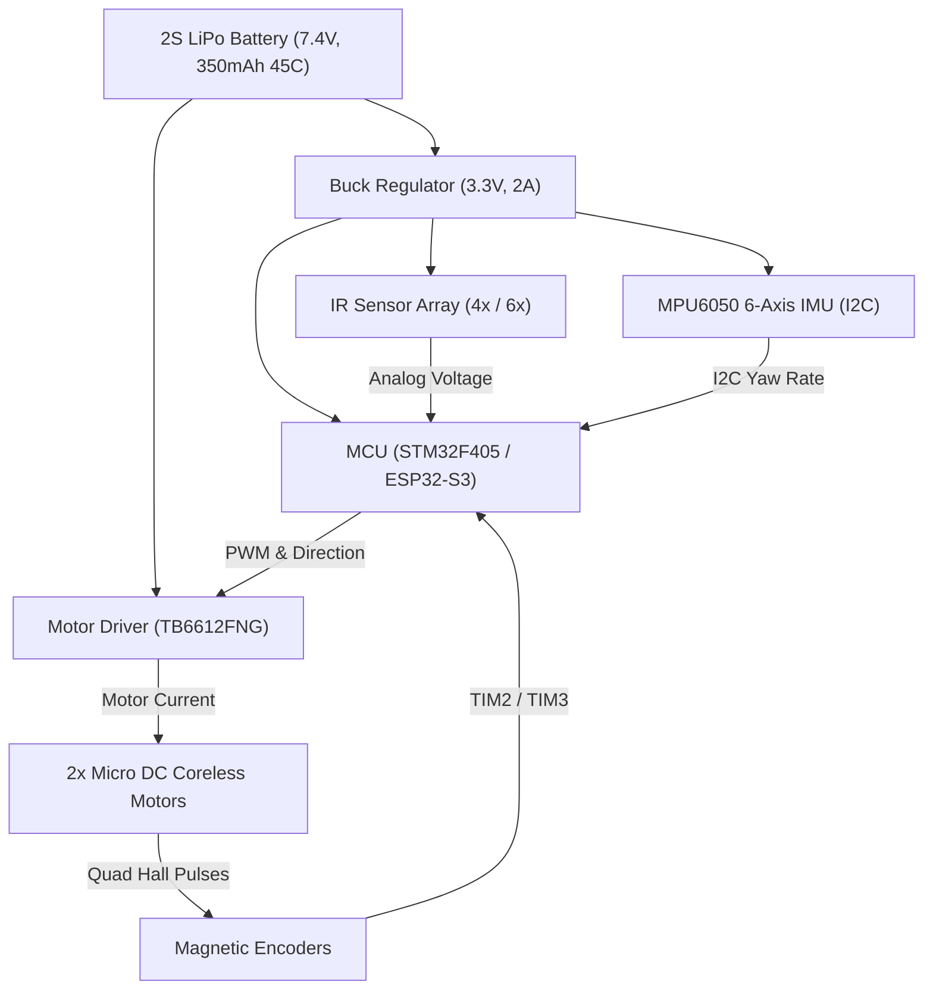

# ⚡ Hardware Circuit & Electrical Architecture: Micromouse

This document outlines the complete schematic architecture, pinout assignments, sensor circuits, and PCB layout guidelines for the Micromouse robot.

---

## 📐 1. System Block Diagram

---

## 🔌 2. Complete Pinout Table

### Recommended STM32F405 / F411 Pinout

| Peripheral Group | Signal Name | MCU Pin | Function / Notes |
|---|---|---|---|
| **Motors (Left)** | `MOT_L_PWM` | `PA8` (TIM1_CH1) | High-frequency PWM (20 kHz) |
| | `MOT_L_IN1` | `PB12` | Direction logic 1 |
| | `MOT_L_IN2` | `PB13` | Direction logic 2 |
| **Motors (Right)**| `MOT_R_PWM` | `PA9` (TIM1_CH2) | High-frequency PWM (20 kHz) |
| | `MOT_R_IN1` | `PB14` | Direction logic 1 |
| | `MOT_R_IN2` | `PB15` | Direction logic 2 |
| **Encoders (Left)**| `ENC_L_A` | `PA0` (TIM2_CH1) | Quadrature Input A |
| | `ENC_L_B` | `PA1` (TIM2_CH2) | Quadrature Input B |
| **Encoders (Right)**| `ENC_R_A` | `PA6` (TIM3_CH1) | Quadrature Input A |
| | `ENC_R_B` | `PA7` (TIM3_CH2) | Quadrature Input B |
| **IR Emitter LEDs**| `IR_TX_L` | `PC0` | Left emitter pulse drive |
| | `IR_TX_FL` | `PC1` | Front-Left emitter pulse drive |
| | `IR_TX_FR` | `PC2` | Front-Right emitter pulse drive |
| | `IR_TX_R` | `PC3` | Right emitter pulse drive |
| **IR Phototransistors**| `IR_RX_L` | `PA2` (ADC1_IN2) | Left wall distance |
| | `IR_RX_FL` | `PA3` (ADC1_IN3) | Front-Left distance |
| | `IR_RX_FR` | `PA4` (ADC1_IN4) | Front-Right distance |
| | `IR_RX_R` | `PA5` (ADC1_IN5) | Right wall distance |
| **IMU (MPU6050)** | `I2C_SCL` | `PB6` | I2C Clock (400 kHz Fast-Mode) |
| | `I2C_SDA` | `PB7` | I2C Data line |
| **User Interface** | `BTN_MODE` | `PC13` | Pushbutton for Run selection |
| | `LED_STATUS`| `PC14` | Visual status & calibration indicator |
| | `BUZZER` | `PB8` | Audible cue for goal reach |

---

## 📡 3. High-Speed IR Sensor Subsystem

In a Micromouse, distance measurement must be fast ($\le 100\ \mu\text{s}$ per channel) and immune to ambient lighting (fluorescent or sunlight).

### Pulsed Synchronous Demodulation Circuit
1. **Emitter Drive**: Each IR LED is powered through an N-channel MOSFET (e.g. 2N7002 or BSS138) driven by a digital MCU pin. A current-limiting resistor ($33\ \Omega$ to $47\ \Omega$) delivers a high-current pulse ($\sim 80\text{ mA}$) for $40\ \mu\text{s}$.
2. **Receiver Circuit**: An IR phototransistor (e.g. TEFT4300 or SFH 203 P) in series with a load resistor ($10\ \text{k}\Omega$ to $47\ \text{k}\Omega$) connected to the MCU ADC.
3. **Differential Sampling Math**:
   $$V_{\text{ambient}} = \text{ADC\_Read}(\text{LED\_OFF})$$
   $$\text{Turn ON LED} \implies \text{delay\_microseconds}(40)$$
   $$V_{\text{signal}} = \text{ADC\_Read}(\text{LED\_ON})$$
   $$\text{Turn OFF LED}$$
   $$V_{\text{true}} = V_{\text{signal}} - V_{\text{ambient}}$$
   This completely removes fluorescent room flicker and ambient shadows!

---

## 🏎️ 4. Motor Driver Architecture (TB6612FNG)

- **$V_M$ Pin**: Connects to the raw battery voltage ($7.4\text{V}$ nominal). Place a $47\ \mu\text{F}$ low-ESR electrolytic capacitor in parallel with a $100\text{ nF}$ ceramic capacitor directly next to the $V_M$ and GND pins.
- **$V_{CC}$ Pin**: Connects to the regulated $3.3\text{V}$ rail.
- **Standby (`STBY`)**: Pulled HIGH (to $3.3\text{V}$) to enable H-Bridge outputs.
- **PWM Frequency**: Set to $20\text{ kHz}$ to eliminate audible motor whine and ensure smooth linear response.

---

## 🛠️ 5. PCB Layout & Noise Isolation Guidelines

1. **Star Grounding**: Separate high-current motor ground paths from sensitive analog sensor / ADC ground. Connect them at a single star point near the battery terminal.
2. **Decoupling Capacitors**: Place $100\text{ nF}$ ceramic decoupling capacitors as close as physically possible to the power pins of the MCU, IMU, and motor driver.
3. **Sensor Symmetry**: Ensure the Left and Right IR sensor pairs are mounted at mirror-image positions and identical angles (typically 45° for diagonal sensors and 90° for side sensors) relative to the chassis centerline.
4. **Mass Distribution**: Center the battery mass directly between the drive wheels to maximize wheel traction and eliminate turning moment of inertia imbalances.
