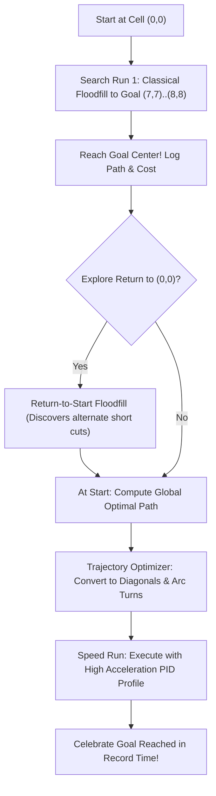

# 💡 Project Ideas & Architecture: Micromouse Robot

This document is the central ideas notebook and system design manual for the **Autonomous Micromouse Robot Project**. It records technical architecture, sensor topologies, multi-run strategies, and algorithmic roadmaps.

---

## 🎯 1. Project Objectives & Competition Standards

Micromouse is a prestigious worldwide robotics contest where an autonomous robot must solve a standard 16×16 walled maze (or 32×32 half-size maze) without any external communication or prior knowledge.

1. **Autonomous Exploration (Search Run)**:
   - Navigate from the starting cell $(0, 0)$ to the 4 center destination cells: $(7, 7), (7, 8), (8, 7), (8, 8)$.
   - Real-time wall discovery and dynamic map updating.
   - Return-to-start exploration to discover alternative paths and confirm the global optimal route.
2. **Path Optimization & Trajectory Smoothing**:
   - Compute the true global minimum-cost trajectory.
   - Transform 90° stop-and-turn movements into smooth circular arcs and diagonal lines (cutting across diagonal pegs).
3. **High-Speed Execution (Speed Run)**:
   - Execute the computed shortest path using closed-loop motor odometry and trapezoidal/S-curve velocity profiles at high acceleration ($> 3\text{ m/s}^2$).

---

## 🛠️ 2. Hardware Architecture & Bill of Materials (BOM)

### Microcontroller Selection
- **Option A (High-Performance Embedded)**: **STM32F405RG / STM32F411CE (BlackPill)**:
  - 32-bit ARM Cortex-M4 @ 168 MHz with Hardware Floating Point Unit (FPU).
  - Dedicated hardware encoder timers (TIM2, TIM3, TIM4) for zero-CPU quadrature decoding.
  - Sub-microsecond ADC sampling for IR sensors.
- **Option B (Rapid Prototyping & Wireless)**: **ESP32-S3 / Teensy 4.0**:
  - Dual-core Xtensa LX7 @ 240 MHz (Core 0: Floodfill & sensor filtering, Core 1: Motor PID & odometry).
  - Built-in Wi-Fi & BLE for real-time telemetry and wireless parameter tuning.

### Sensor Topology
- **Configuration**: 4-channel or 6-channel IR reflectance sensor array (Infrared Emitters + Phototransistors):
  - **Left Wall Sensor (90°)**: Detects distance to the left wall for centering.
  - **Right Wall Sensor (90°)**: Detects distance to the right wall for centering.
  - **Front-Left Diagonal (45°)**: Senses impending front walls early and detects posts/pegs for turning cues.
  - **Front-Right Diagonal (45°)**: Symmetric right-side diagonal sensing.
  - **Front Center Sensor**: Detects dead-ends and perpendicular walls when approaching a cell boundary.
- **Ambient Light Cancellation**: Pulse modulation (emitters pulsed for $50\ \mu\text{s}$, read ambient baseline $\to$ fire LED $\to$ read signal $\to$ subtract baseline).

### Motor Drive & Actuation
- **Motors**: Faulhaber / Pololu 10mm or 12mm Coreless DC Micro Metal Gearmotors (1:10 or 1:30 gear ratio, 1500–3000 RPM).
- **Encoders**: Magnetic quadrature encoders on motor rear shafts (12 CPR $\times 30 = 360$ counts per wheel rotation).
- **Motor Driver**: TB6612FNG or DRV8833 Dual H-Bridge (low $R_{DS(on)}$, minimal thermal dissipation).
- **Chassis & Wheels**: Two custom 3D-printed wheels with silicone high-grip O-rings / rubber tires; low-friction rear Delrin skid pad.
- **Power Subsystem**: 2S LiPo battery (7.4V, 300–450 mAh, 45C discharge rating) with a high-efficiency 3.3V/5V buck-boost regulator.

---

## 🧠 3. Multi-Run Strategy

### Run 1: Classical Floodfill Exploration
- Robot starts at cell $(0, 0)$ facing North.
- At each cell:
  1. Sample IR sensors $\implies$ register presence/absence of walls (North, East, South, West).
  2. Update global 16×16 maze wall bitmask.
  3. Recompute distance potential values using BFS queue Floodfill if walls were newly discovered.
  4. Move to the adjacent neighbor with the lowest potential value.
  5. Repeat until entering one of the center goal cells $\{(7, 7), (7, 8), (8, 7), (8, 8)\}$.

### Run 2: Return to Start
- Set destination potential 0 at $(0, 0)$.
- Floodfill back to start. This explores unmapped cells on the return journey, often discovering shorter diagonal corridors than the forward path.

### Run 3+: Speed Run (Diagonal Acceleration)
- Path is converted into high-level primitives:
  - `FORWARD(n)`: Accelerate through $n$ contiguous straight cells without stopping at intermediate boundaries.
  - `SMOOTH_TURN_90(dir)`: Circular arc turn at constant linear velocity (e.g., $0.8\text{ m/s}$).
  - `DIAGONAL(n)`: 45° zigzag transition through open pegs for maximum speed.

---

## 🔬 4. Control Architecture

1. **Cascaded PID Controllers**:
   - **Inner Loop (1 kHz)**: Motor current / velocity PID using encoder feedback.
   - **Middle Loop (200 Hz)**: Heading angle PID using MPU6050 Gyro yaw rate ($\dot{\theta}$).
   - **Outer Loop (100 Hz)**: Cross-track position correction using IR distance sensors (Wall Centering).
2. **Wall Centering Error Formula**:
   $$\text{Error}_{\text{centering}} = (D_{\text{Left}} - D_{\text{Right}}) - (D_{\text{nominal\_Left}} - D_{\text{nominal\_Right}})$$
   When only one wall is present:
   $$\text{Error}_{\text{centering}} = D_{\text{Left}} - D_{\text{nominal\_Left}} \quad (\text{if only Left wall exists})$$
   $$\text{Error}_{\text{centering}} = -(D_{\text{Right}} - D_{\text{nominal\_Right}}) \quad (\text{if only Right wall exists})$$

---

## 🔮 5. Future Brainstorming & Research Ideas

1. **Modified Floodfill (Run-time Diagonal Weighting)**:
   - Traditional floodfill counts cell hops ($+1$ per orthogonal step).
   - Modified Floodfill adds turn penalties ($\text{cost}_{\text{straight}} = 1.0, \text{cost}_{\text{turn}} = 1.5$) to favor long straightaways over frequent turns.
2. **Sensor Fusion via Extended Kalman Filter (EKF)**:
   - Combine wheel encoder odometry, accelerometer linear acceleration, and gyro yaw rate to eliminate drift and wheel slip error.
3. **Web-Based Real-Time Telemetry**:
   - Stream live maze discovery, floodfill potentials, and sensor readings over WebSockets using the ESP32 Wi-Fi core.
